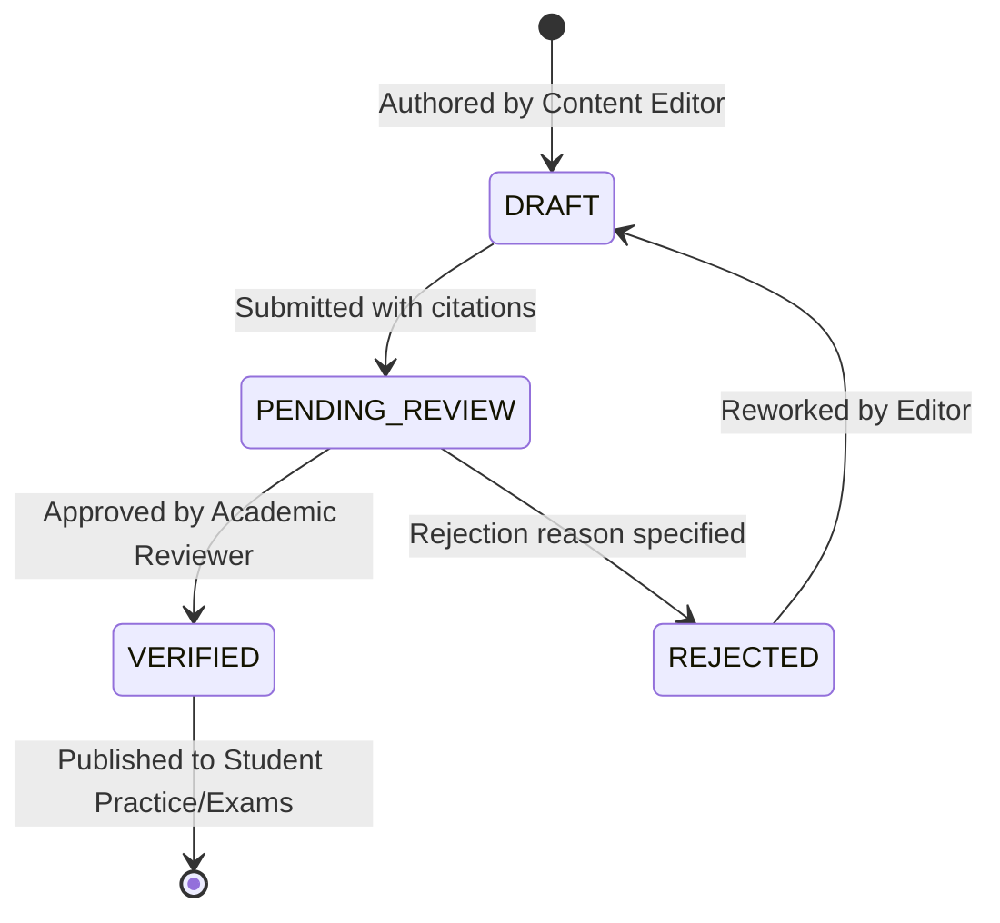
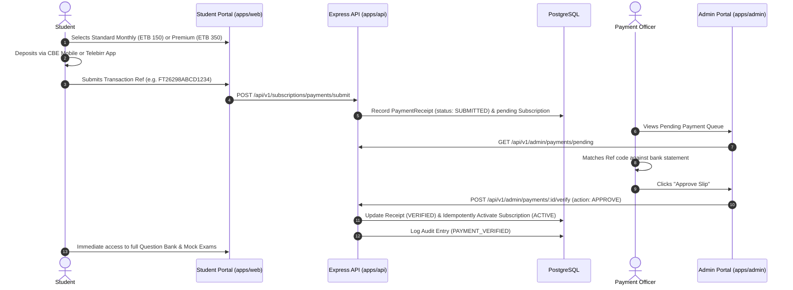

# ExitPrep Ethiopia — MVP Implementation Plan & Blueprint

## 1. Product Overview

**ExitPrep Ethiopia** is a specialized, mobile-first web platform engineered for Ethiopian university graduates preparing for the **National University Exit Examination** and TVET candidates preparing for the **Center of Competence (COC) Competency Assessment**.

### Finalized Product Decisions

| Decision | MVP Choice | Rationale |
| :--- | :--- | :--- |
| **Product** | ExitPrep Ethiopia | National identity, clear focus on graduation & qualification exams |
| **Platform** | Responsive Web App | Immediate mobile access across all Ethiopian smartphones without store friction |
| **Language** | English | Official language of instruction for Ethiopian university exit exams |
| **University Exit Exam** | Business Departments | Accounting & Finance, Management, Economics, Marketing Management |
| **COC Competency Exam** | Configurable Catalog | Designed architecture; units unpublished pending official standards verification |
| **Frontend** | React + TypeScript + Tailwind | Rapid, type-safe, lightweight responsive interface |
| **Backend** | Node.js + Express + TypeScript | Lightweight, proven API server with robust middleware architecture |
| **Database** | PostgreSQL + Prisma ORM | Relational integrity, typed queries, safe migrations, audit logs |
| **Monorepo** | pnpm + Turborepo | Shared schemas, unified typing, clean modular boundaries |
| **Auth** | JWT + Role-Based Access Control | 5 clear roles: Student, Editor, Reviewer, Payment Officer, Super Admin |
| **Payments** | Manual Verification (CBE & Telebirr) | Frictionless adoption matching Ethiopian local banking habits |
| **Revenue Model** | Free Practice + Paid Subscriptions | Inclusive basic access, monetization via full mock exams & diagnostics |

---

## 2. Core Content Rule & Verification Policy

> **MANDATORY CONTENT INTEGRITY PRINCIPLE:**
> We will **NOT** invent official curricula, exam blueprints, competency standards, or official questions. The software platform is engineered prior to final content finalization; all content **MUST remain unpublished** until verified by qualified reviewers against official Ministry of Education (MoE) or Regional Assessment Center guidelines.

### Content Lifecycle:

---

## 3. Five-Role Access Control Matrix

| Role | Permissions & Scope |
| :--- | :--- |
| **STUDENT** | Practice free questions, take mock exams, submit CBE/Telebirr payment slips, review personal attempt history. |
| **CONTENT_EDITOR** | Draft questions, link questions to course topics, specify official source citations, edit rejection feedback. |
| **REVIEWER** | Inspect submitted questions, verify citations against official blueprints, approve or reject with comments. |
| **PAYMENT_ADMINISTRATOR** | Review pending CBE and Telebirr payment submissions, verify transaction reference against statements, approve/reject slips. |
| **SUPER_ADMINISTRATOR** | Manage user accounts, assign roles, configure university programs and COC occupations, inspect full audit trail. |

---

## 4. Payment Verification Workflow (CBE & Telebirr)

---

## 5. Development Roadmap & Milestones

1. **Milestone 1 (Current): Foundation & Setup**
   - Monorepo structure with pnpm & Turborepo.
   - Complete Prisma PostgreSQL schema and verified migration (`20261027000000_init`).
   - Shared package with enums, DTOs, and request contracts.
   - Express API with health check, authentication, practice, exams, and payment endpoints.
   - Responsive web student portal (`apps/web` on port 5173).
   - Administrative portal starter (`apps/admin` on port 5174).
2. **Milestone 2: Academic Program & Blueprint Ingestion**
   - Verification of MoE business blueprints with university department heads.
   - Multi-course curriculum tree ingestion.
3. **Milestone 3: Peer-Reviewed Question Bank Expansion**
   - Question authoring tooling for certified academic contributors.
   - Double-blind reviewer workflows.
4. **Milestone 4: Mock Exam Simulator & Analytics**
   - High-fidelity MoE exam screen simulator with question navigation grid and timer warnings.
   - Detailed topic diagnostic reports.
5. **Milestone 5: Production Deployment & Pilot Launch**
   - Production Docker packaging, PostgreSQL managed deployment, CDN asset caching.
